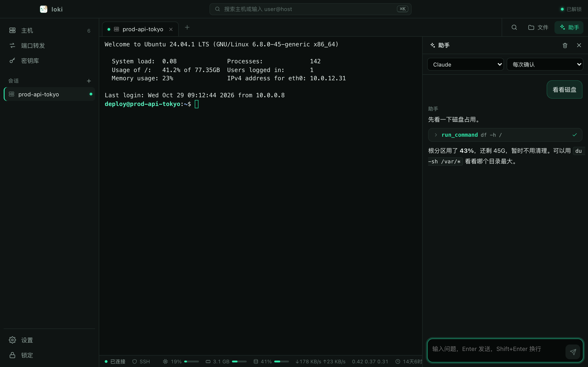
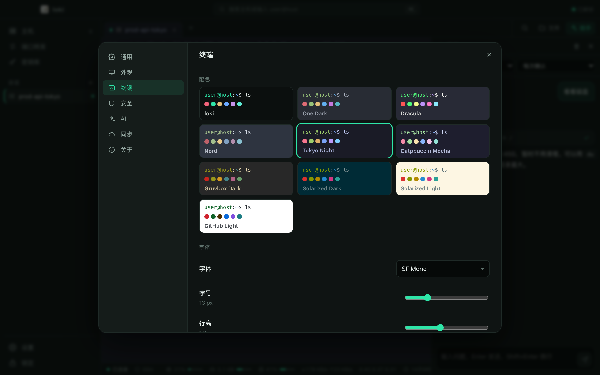

<p align="center">
  
</p>

<h1 align="center">loki</h1>

<p align="center">
  A desktop SSH client with an AI assistant beside every terminal.<br/>
  Your hosts, keys and passwords stay encrypted on your machine.
</p>

<p align="center">
  <b>English</b> · <a href="README.zh-CN.md">简体中文</a>
</p>

<p align="center">
  <a href="../../releases/latest">Download</a> ·
  <a href="#features">Features</a> ·
  <a href="#security-model">Security</a> ·
  <a href="#build-from-source">Build</a>
</p>


## Download

Get the latest installer from the [Releases page](../../releases/latest).

| Platform | File |
|---|---|
| macOS, Apple silicon (M1/M2/M3/M4) | `loki_<version>_aarch64.dmg` |
| macOS, Intel | `loki_<version>_x64.dmg` |
| Windows 10/11 (64-bit) | `loki_<version>_x64-setup.exe` (or the `.msi`) |

**The builds are not code-signed yet**, so your OS will warn on first launch:

- **macOS** — if you see *"loki is damaged and can't be opened"*, move it to Applications and run
  `xattr -dr com.apple.quarantine /Applications/loki.app` in Terminal, then open it again.
  If you see *"cannot verify the developer"*, right-click the app → **Open** → **Open**.
- **Windows** — SmartScreen shows *"Windows protected your PC"*: click **More info** → **Run anyway**.
  The installer downloads Microsoft WebView2 if your system does not have it.

The interface is currently in Simplified Chinese.

## Features

| | |
|---|---|
| **Terminals** | SSH, Telnet, serial and local shells in tabs; tabs keep their screen and scrollback when you switch; find in terminal; export the scrollback or **record** a session to a file (escape codes stripped, switch pager prompts cleaned up); a status bar with CPU, memory, disk, network and load for SSH hosts |
| **Connecting** | Trust-on-first-use host keys stored in the vault, with a loud warning when a key *changes*; tries the host's key → a key from the key vault → ssh-agent → password, and asks for a password when nothing works; keyboard-interactive for PAM servers; jump hosts (ProxyJump); quick connect over SSH, Telnet, serial or a local shell without saving a host first, then save it as a host in one click |
| **Files (SFTP)** | A panel beside the terminal on the same connection; upload and download files *and folders* with progress and cancel; drag-and-drop upload; rename, new file/folder, recursive delete; built-in editor |
| **Port forwarding** | Local (`-L`) and SOCKS5 (`-D`) |
| **AI assistant** | OpenAI Chat Completions–compatible APIs (OpenAI, OpenRouter, DeepSeek, Ollama, LM Studio, vLLM…), OpenAI Responses and Anthropic; replies **stream** in as they are written, with tool calls shown inline where they happen; it can read the terminal, run commands, list/read/write files and grep — with three permission modes, and changes to the server need your approval by default; **attach local files** (certificates, scripts): they are uploaded to a staging folder on the server for the assistant to use, and private key contents are never sent to the model; **conversation history** per host, encrypted on this machine and never synced |
| **Keys** | Generate Ed25519 / RSA-4096, import OpenSSH or PEM keys (with passphrase) |
| **Import** | Bring hosts in from `~/.ssh/config`, including identity files and ProxyJump |
| **Vault** | Master password with a one-time recovery code you can copy or save to a file; auto-lock after inactivity |
| **Sync (optional)** | To a Cloudflare Worker + D1 that *you* deploy; the server only ever sees ciphertext — see [`workers/sync`](workers/sync) |
| **Look** | Dark and light themes (or follow the system); 10 terminal colour schemes (loki, One Dark, Dracula, Nord, Tokyo Night, Catppuccin Mocha, Gruvbox, Solarized dark/light, GitHub Light); font, size, cursor and scrollback settings |
| **Updates** | Checks for new releases and installs them in place; every update package is signature-verified |

<table>
  <tr>
    <td></td>
    <td></td>
  </tr>
  <tr>
    <td></td>
    <td></td>
  </tr>
</table>

### Keyboard

| macOS | Windows | |
|---|---|---|
| ⌘T / ⌘K | Ctrl+Shift+T / K | New connection / quick connect (⌘K inside a terminal clears it) |
| ⌘W | Ctrl+Shift+W | Close tab |
| ⌘1…9, ⌘⇧[ ] | Ctrl+Shift+1…9, [ ] | Switch tabs |
| ⌘F | Ctrl+Shift+F | Find in terminal |
| ⌘C / ⌘V | Ctrl+Shift+C / V | Copy / paste in terminal |
| ⌘, | Ctrl+Shift+, | Settings |
| ⌘L | Ctrl+Shift+L | Lock |

On Windows plain Ctrl stays with the shell (Ctrl+C, Ctrl+W…), as in Windows Terminal.

## Security model

1. **Secrets never leave the Rust process.** The UI is told *whether* a host has a password, never the password. Private keys picked from disk are read by Rust, not by the WebView.
2. **The local database holds ciphertext only.** Hosts, keys, API keys and trusted host keys are each sealed with AES-256-GCM under a vault key; the vault key is wrapped by a key derived from your master password with Argon2id (64 MiB, t=3, p=4).
3. **Ciphertexts are bound to their identity.** Each item uses `loki/item/v1/{id}` as associated data, so moving a blob to another row makes it fail to decrypt.
4. **No silent trust.** An unknown host key is shown for confirmation; a changed one is shown with the old and new fingerprints side by side.

Data lives in `~/Library/Application Support/app.loki.desktop/` on macOS and `%APPDATA%\app.loki.desktop\` on Windows. loki has not had a third-party security audit.

## Build from source

Requirements: [Rust](https://rustup.rs) (stable), Node.js 20+, pnpm, and the
[Tauri prerequisites](https://tauri.app/start/prerequisites/) for your OS.

```bash
pnpm install
pnpm tauri dev          # run the app
pnpm tauri build        # installers in src-tauri/target/release/bundle/
```

Useful while developing:

```bash
LOKI_DATA_DIR=/tmp/loki-dev pnpm tauri dev   # use a throwaway vault
pnpm dev                                     # then open http://localhost:5273/dev/mock.html
                                             # (the whole UI against a fake backend)
```

Tests:

```bash
cd src-tauri
cargo test                                   # unit tests
cargo clippy --all-targets -- -D warnings
```

Live integration tests (`tests/ssh_live.rs`, `tests/chain_live.rs`) run against a throwaway sshd on `127.0.0.1:2222`; [docs/STATUS.md](docs/STATUS.md) has a ready-made config.

Releases are built by GitHub Actions ([`.github/workflows/release.yml`](.github/workflows/release.yml)) when a `v*` tag is pushed.

## Project layout

```
src/                       React + TypeScript UI (Zustand stores, xterm.js)
  lib/api.ts               the single IPC boundary
src-tauri/src/
  crypto.rs, vault.rs      Argon2id → HKDF → AES-256-GCM; key lifecycle
  store.rs                 SQLite, ciphertext only
  ssh.rs                   connect chain, host-key policy, auth, PTY shell
  local.rs                 local shell (portable-pty)
  sftp.rs, transfer.rs     file panel, upload / download
  forward.rs, stats.rs     port forwarding, status-bar readings
  sshconfig.rs             ~/.ssh/config import
  ai/                      model providers, tools, turn loop
  commands.rs              IPC commands
workers/sync/              optional Cloudflare Worker for sync
dev/mock.html              browser-only UI with a fake backend
docs/STATUS.md             what is verified, and how (Chinese)
```

## Acknowledgements

loki's architecture follows an analysis of [Hatoba](https://github.com/scarletkc/Hatoba)
(MIT), an open-source SSH client with the same "secrets stay in Rust, ciphertext
everywhere" design. loki is an independent reimplementation, not a fork.

Built with [Tauri](https://tauri.app), [russh](https://github.com/Eugeny/russh),
[xterm.js](https://xtermjs.org) and React.

## License

[MIT](LICENSE)
