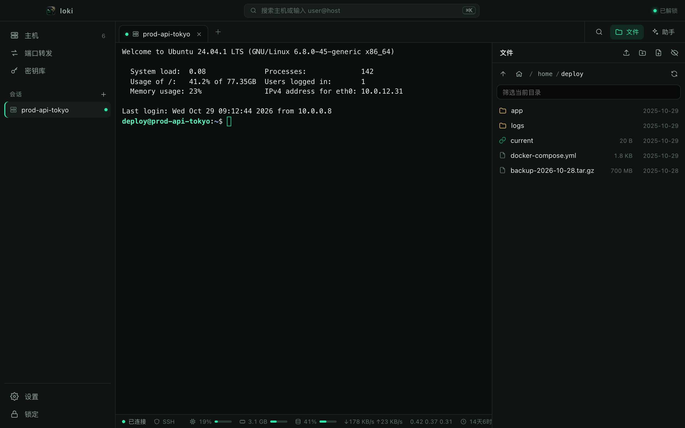
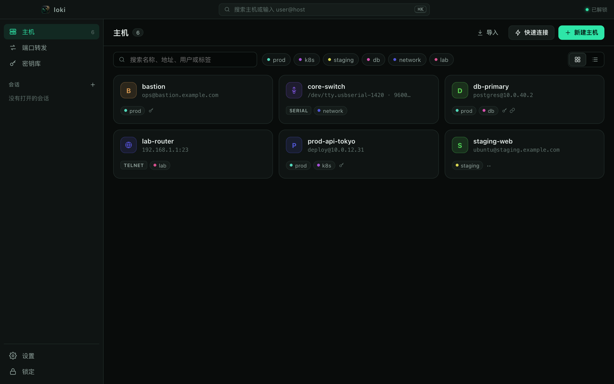
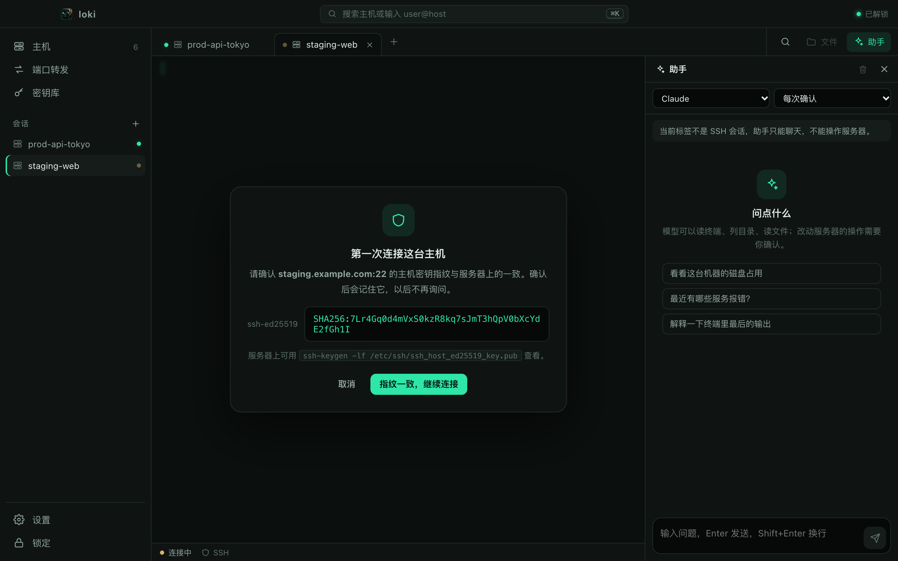
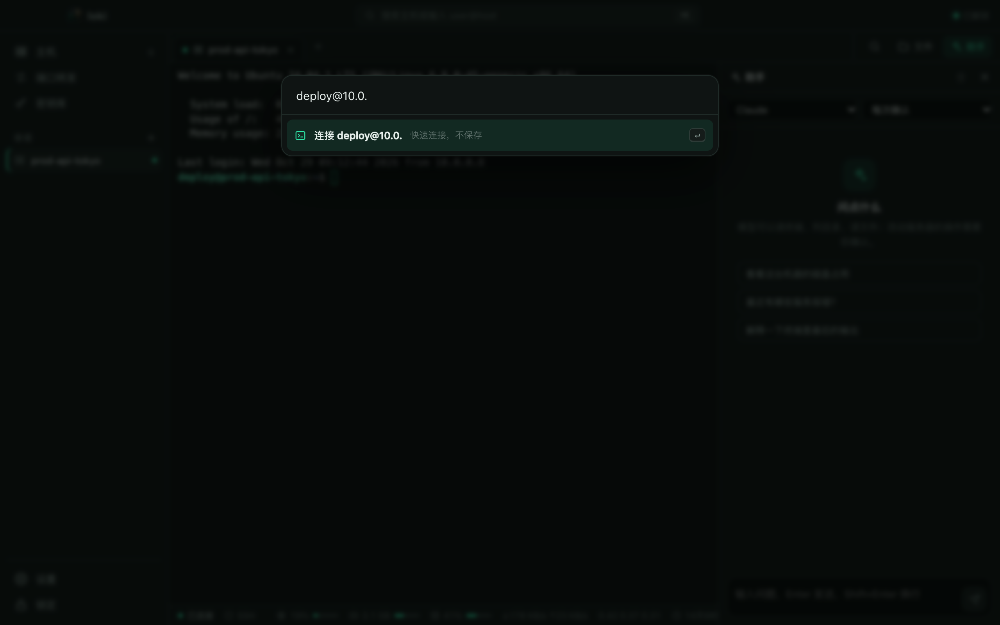
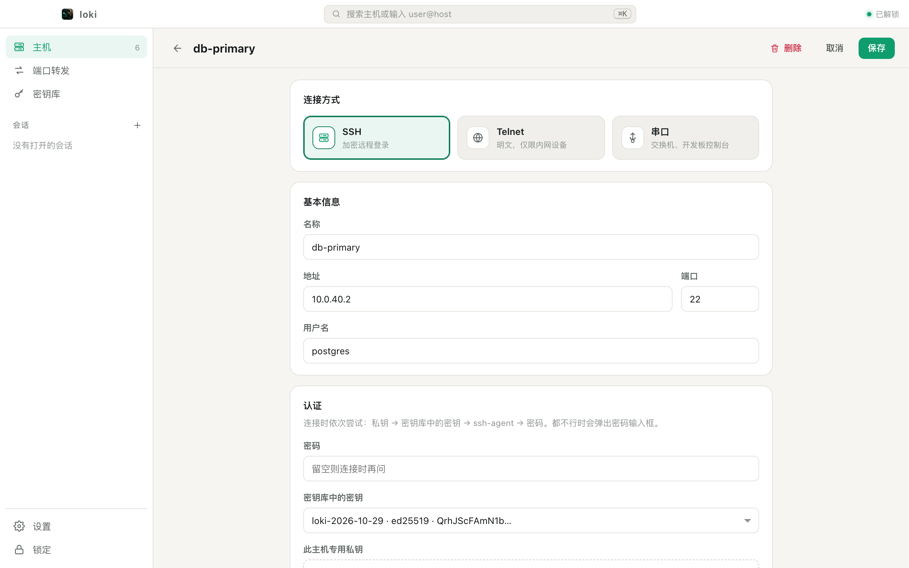

<p align="center">
  
</p>

<h1 align="center">loki</h1>

<p align="center">
  每个终端旁边都有 AI 助手的桌面 SSH 客户端。<br/>
  主机、密钥和密码都加密保存在你自己的电脑上。
</p>

<p align="center">
  <a href="README.md">English</a> · <b>简体中文</b>
</p>

<p align="center">
  <a href="../../releases/latest">下载</a> ·
  <a href="#功能">功能</a> ·
  <a href="#安全设计">安全设计</a> ·
  <a href="#从源码构建">从源码构建</a>
</p>



## 下载

到 [Releases 页面](../../releases/latest) 下载最新安装包：

| 平台 | 文件 |
|---|---|
| macOS，Apple 芯片（M1/M2/M3/M4） | `loki_<版本>_aarch64.dmg` |
| macOS，Intel 芯片 | `loki_<版本>_x64.dmg` |
| Windows 10/11（64 位） | `loki_<版本>_x64-setup.exe`（或 `.msi`） |

**安装包暂未做代码签名**，第一次打开时系统会拦截：

- **macOS**：如果提示 *“loki 已损坏，无法打开”*，先把它拖进“应用程序”，然后在终端里执行
  `xattr -dr com.apple.quarantine /Applications/loki.app`，再打开即可。
  如果提示 *“无法验证开发者”*，在 app 上点右键 → **打开** → **打开**。
- **Windows**：SmartScreen 会提示 *“Windows 已保护你的电脑”*，点 **更多信息** → **仍要运行**。
  如果系统没有 Microsoft WebView2，安装程序会自动下载。

## 功能

| | |
|---|---|
| **终端** | SSH、Telnet、串口、本地 shell 多标签；切换标签时屏幕和回滚历史都保留；终端内查找；SSH 主机的状态栏显示 CPU、内存、磁盘、网速和负载 |
| **连接** | 主机密钥首次确认后加密保存，密钥**变化**时红色警告；依次尝试主机私钥 → 密钥库中的密钥 → ssh-agent → 密码，都不行时弹出密码框；支持只开了 PAM 的服务器（keyboard-interactive）；跳板机（ProxyJump）；输入 `user@host:port` 快速连接 |
| **文件（SFTP）** | 终端旁的文件面板，复用同一条连接；上传、下载文件和**整个文件夹**，有进度、可取消；拖拽上传；重命名、新建、递归删除；内置编辑器 |
| **端口转发** | 本地转发（`-L`）和 SOCKS5（`-D`） |
| **AI 助手** | 支持 OpenAI 兼容接口（OpenAI、OpenRouter、Ollama、LM Studio、vLLM 等）和 Anthropic；能读终端、执行命令、列目录、读写文件、grep；三种权限模式，默认情况下任何改动服务器的操作都要你确认 |
| **密钥** | 生成 Ed25519 / RSA-4096，导入 OpenSSH 或 PEM 私钥（支持口令） |
| **导入** | 从 `~/.ssh/config` 一键导入主机，私钥文件和跳板机一并带入 |
| **保险库** | 主密码 + 一次性恢复码；空闲自动锁定 |
| **同步（可选）** | 同步到**你自己**部署的 Cloudflare Worker + D1，服务端只见到密文，见 [`workers/sync`](workers/sync) |
| **外观** | 深色、浅色或跟随系统；终端字体、字号、光标、回滚行数可调 |

<table>
  <tr>
    <td></td>
    <td></td>
  </tr>
  <tr>
    <td></td>
    <td></td>
  </tr>
</table>

### 快捷键

| macOS | Windows | |
|---|---|---|
| ⌘T / ⌘K | Ctrl+Shift+T / K | 新建连接 / 快速连接（终端内 ⌘K 为清屏） |
| ⌘W | Ctrl+Shift+W | 关闭标签 |
| ⌘1…9、⌘⇧[ ] | Ctrl+Shift+1…9、[ ] | 切换标签 |
| ⌘F | Ctrl+Shift+F | 终端内查找 |
| ⌘C / ⌘V | Ctrl+Shift+C / V | 终端内复制 / 粘贴 |
| ⌘, | Ctrl+Shift+, | 设置 |
| ⌘L | Ctrl+Shift+L | 锁定 |

Windows 上单独的 Ctrl 留给 shell 使用（Ctrl+C、Ctrl+W 等），与 Windows Terminal 的习惯一致。

## 安全设计

1. **秘密不出 Rust 进程。** 界面只知道某台主机“有没有保存密码”，拿不到密码本身。从磁盘选择的私钥文件也由 Rust 读取，不经过 WebView。
2. **本地数据库只存密文。** 主机、密钥、API Key、已信任的主机密钥都用保险库密钥做 AES-256-GCM 加密；保险库密钥再由主密码经 Argon2id（64 MiB，t=3，p=4）派生的密钥加密。
3. **密文绑定身份。** 每个条目以 `loki/item/v1/{id}` 作为附加数据加密，把密文挪到别的行就无法解密。
4. **不静默信任。** 未知主机密钥要你确认；密钥变化时并排显示新旧指纹。

数据位置：macOS 为 `~/Library/Application Support/app.loki.desktop/`，Windows 为 `%APPDATA%\app.loki.desktop\`。本项目未经第三方安全审计。

## 从源码构建

需要 [Rust](https://rustup.rs)（stable）、Node.js 20+、pnpm，以及对应系统的
[Tauri 依赖](https://tauri.app/start/prerequisites/)。

```bash
pnpm install
pnpm tauri dev          # 运行
pnpm tauri build        # 安装包输出到 src-tauri/target/release/bundle/
```

开发时常用：

```bash
LOKI_DATA_DIR=/tmp/loki-dev pnpm tauri dev   # 使用临时保险库，不碰正式数据
pnpm dev                                     # 然后打开 http://localhost:5273/dev/mock.html
                                             # （整个界面接一个模拟后端，在浏览器里调样式）
```

测试：

```bash
cd src-tauri
cargo test                                   # 单元测试
cargo clippy --all-targets -- -D warnings
```

实机集成测试（`tests/ssh_live.rs`、`tests/chain_live.rs`）连接 `127.0.0.1:2222` 上的临时 sshd，配置方法见 [docs/STATUS.md](docs/STATUS.md)。

推送 `v*` 标签后，GitHub Actions（[`.github/workflows/release.yml`](.github/workflows/release.yml)）会自动构建 macOS 和 Windows 安装包并发布。

## 目录结构

```
src/                       React + TypeScript 前端（Zustand、xterm.js）
  lib/api.ts               唯一的 IPC 边界
src-tauri/src/
  crypto.rs, vault.rs      Argon2id → HKDF → AES-256-GCM；密钥生命周期
  store.rs                 SQLite，只存密文
  ssh.rs                   连接链、主机密钥策略、认证、PTY
  local.rs                 本地 shell（portable-pty）
  sftp.rs, transfer.rs     文件面板、上传下载
  forward.rs, stats.rs     端口转发、状态栏采样
  sshconfig.rs             ~/.ssh/config 导入
  ai/                      模型服务商、工具、对话循环
  commands.rs              IPC 命令
workers/sync/              可选的 Cloudflare Worker 同步服务
dev/mock.html              浏览器里运行的模拟界面
docs/STATUS.md             已验证内容与验证方式
```

## 致谢

loki 的架构参考了对 [Hatoba](https://github.com/scarletkc/Hatoba)（MIT）的分析。Hatoba 是一个开源 SSH 客户端，采用同样的“秘密只在 Rust、处处只存密文”设计。loki 是独立重写的实现，不是它的分支。

基于 [Tauri](https://tauri.app)、[russh](https://github.com/Eugeny/russh)、[xterm.js](https://xtermjs.org) 和 React 构建。

## 许可证

[MIT](LICENSE)
